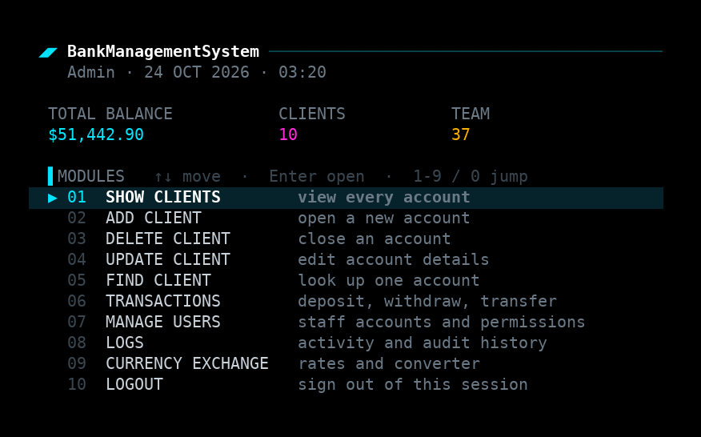
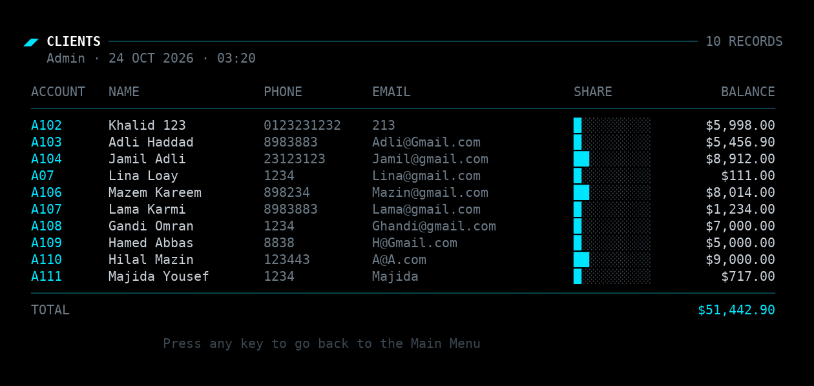
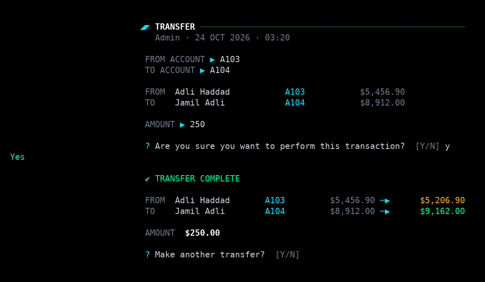
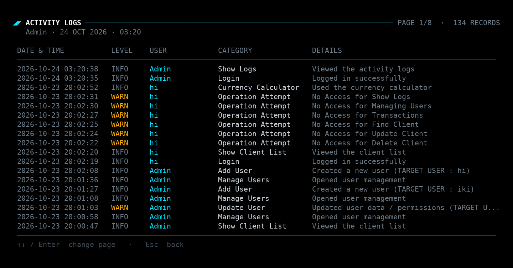
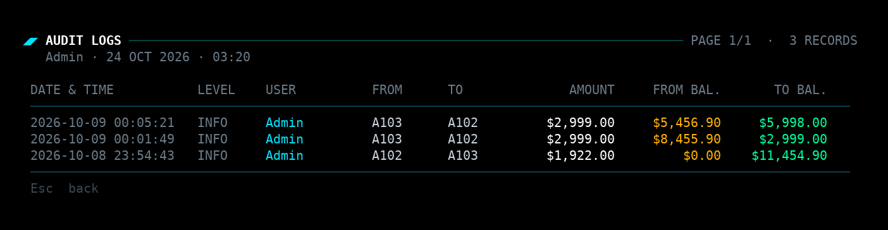
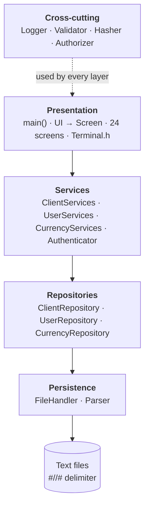
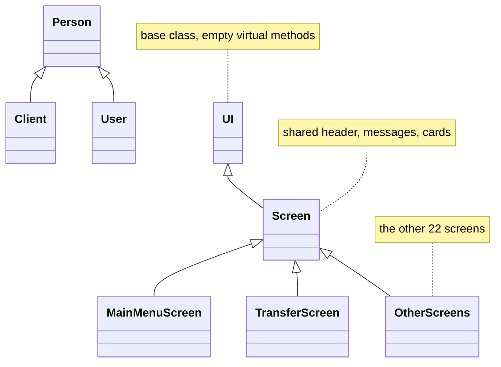

# BankManagementSystem

A console bank management system in C++ with staff accounts, per-user permissions, currency exchange and full activity logging. It's my first real OOP project in C++, and the first thing I've built that is bigger than a single file.

I started it in August 2026 as a side project, only to learn. Before this I knew very basic OOP in Java from uni, so I followed a roadmap and learned each piece by building it here.



## Contents

- [What it does](#what-it-does)
- [Screenshots](#screenshots)
- [How to run](#how-to-run)
- [Project structure](#project-structure)
- [Architecture and design patterns](#architecture-and-design-patterns)
- [Permissions](#permissions)
- [Logging](#logging)
- [Data](#data)
- [Why I made these choices](#why-i-made-these-choices)
- [What was hard](#what-was-hard)
- [How it was built](#how-it-was-built)
- [Known limitations](#known-limitations)
- [What I'd do differently](#what-id-do-differently)
- [License](#license)

## What it does

- Login with username and password
- **Clients:** list, add, delete, update, find
- **Transactions:** deposit, withdraw, transfer, and a total of all balances
- **Users** (the staff who use the system): list, add, delete, update, find, each with their own permissions
- **Currency exchange:** list currencies, find one, update a rate, and a currency calculator
- **Logs:** an activity log, plus a separate audit log for transfers

## Screenshots

Login:


Client list:



A transfer, showing the sender and receiver balances before and after:



Activity logs (the WARN lines are a user trying things they have no permission for):



Audit logs (transfers only):



> These images are renders of the program's real output, made by running the program in a terminal emulator and drawing the result. They aren't captures of the Windows console, so the font looks slightly different from what you'll see on your machine. The data shown is the fake test data from the repo.

## How to run

Windows only (it uses `windows.h` for the console). Needs Visual Studio with C++ support.

1. Clone the repo:
   ```
   git clone https://github.com/0cMuhammed/BankManagementSystem
   ```
2. Open `BankOOP.slnx` in Visual Studio.
3. The project is set to the `v145` toolset and C++20. If you have an older Visual Studio, retarget the toolset in Project Properties and keep the language standard on C++20.
4. Build and run (x64).
5. Log in with:
   - username: `Admin`
   - password: `123`

Run it with the project folder as the working directory (Visual Studio does this by default), because the data files are read with relative paths.

In the menu you can move with the arrow keys and Enter, or jump with the number keys. Esc goes back.

## Project structure

I split the code into layers so each class has one job:

| Layer | Files | Job |
|---|---|---|
| Entities | `Person.h`, `Client.h`, `User.h`, `Currency.h` | The data and the rules of each object |
| Storage | `FileHandler`, `Parser`, `*Repository.h` | Read and write the text files, convert text to objects and back |
| Logic | `Service.h`, `*Services.h`, `Transactions.h`, `Authenticator.h`, `Authorizer.h`, `Validator.h` | The actual operations and the permission checks |
| Screens | `*Screen.h` (24 screens) | What the user sees and types |
| Support | `Logger.h`, `Hasher.h`, `Session.h`, `Date.h`, `Global.h`, `Terminal.h` | Logging, passwords, the current session, dates, constants, console output |

## Architecture and design patterns

The project is a layered architecture. Each layer only talks to the one below it, and the screens never touch the files directly.



The class hierarchies:



### Patterns used

| Pattern | Where | What it does here |
|---|---|---|
| Layered architecture | whole project | Presentation → Services → Repositories → Persistence |
| Repository | `ClientRepository`, `UserRepository`, `CurrencyRepository` | Each one owns a `std::vector` of its objects and syncs it with the text file through `FileHandler` |
| Service layer and facade | `Service`, `Repository` | One object that holds all the sub-services (or sub-repositories), so a screen receives one reference instead of many |
| Dependency injection (constructor, by reference) | `Service(Repository&)`, `ClientServices(ClientRepository&)`, `Authenticator(UserRepository&)`, `ListScreen` | Nothing creates its own dependencies. Everything is wired in `main()` and passed down |
| Inheritance and polymorphism | `UI` → `Screen` → 24 screens, `Person` → `Client` / `User` | `main()` holds the current screen as a `std::unique_ptr<UI>`, and `Screen` holds what all screens share (header, messages, cards). `Person` holds what clients and users share |
| Const-correct accessors | every `Access...()` method | Each one has a `const` version (read only) and a non-const one (mutable). A screen that only shows data gets a `const&`, so it can't change anything |
| Null object and lifecycle flag | `ObjectMode` (`EmptyMode`, `ExistingMode`, `newMode`, `DeleteMode`) | An "empty" `Client` or `User` object stands for "not found", instead of a null pointer. The same flag marks new and deleted objects |
| Result enums | `OperationStates` in each repository | Operations return `Successful`, `AccountNumberNotFound`, `InsufficentBalance` and so on instead of throwing or returning a bare `bool` |
| Static utility classes | `FileHandler`, `Parser`, `Validator`, `Hasher`, `Logger` | Classes with only static functions and no state, used wherever they are needed |
| RBAC with bit flags | `Authorizer`, permissions stored as `1 << n` | One `int32_t` holds all 15 permissions of a user |
| Session object | `Session` | Holds the current logged-in user and is passed to the main menu |
| Audit logging | `Logger` with `Category` and `Level` enums | Every action goes to `Logs.txt`, and transfers also go to `AuditLogs.txt` |
| Generic paging with callables | `Terminal.h` | A template that takes the header, layout and row printers as functions, so every paged screen reuses the same code (this part was AI-assisted) |

Some modern C++ habits are used throughout as well: Rule of Zero in `Person` (the strings manage their own memory), `std::move` in constructors, `std::unique_ptr`, `enum class`, and references instead of raw pointers.

### Where the architecture leaks

These are things I noticed myself while going through the code, and they are the first things I want to fix in the refactor:

- `UI` has empty `virtual` methods instead of pure virtual ones, so nothing forces a screen to implement them.
- The repositories also ask the user for input and print prompts (for example reading the account number), which belongs in the screens.
- `UserServices` and `CurrencyServices` only pass the repository through, so the real logic lives in the repositories and in `Transactions`.
- `Authenticator` writes its own log lines, so authentication and logging are mixed.
- `Service` hands out its sub-services through `Access...()` getters, so callers reach deep into the object (`service.AccessClientServices().AccessRepository()`).

## Permissions

Every user has a set of permissions, and the menu only lets them into what they have access to. I did this to learn RBAC. Permissions are stored as bit flags in a single `int32_t` (`1 << n`), and the Admin has all of them. There are 15 permissions, covering things like `AddClient`, `Transactions`, `ShowAuditLogs` and `ManageUsers`.

## Logging

Every important action is logged with a level (INFO, WARN, ERROR, FATAL), the time, the category and the username of who did it. Attempts to use something without permission are logged as warnings. Transfers also go to a separate audit file and record the sender, the receiver, the amount and the balance before and after.

## Data

Everything is stored in plain text files, with `#//#` as the delimiter between fields. I used it instead of a comma because commas show up in normal text (names, emails) and break parsing very easily.

| File | Content |
|---|---|
| `ClientsData.txt` | clients |
| `UsersData.txt` | users and their permissions |
| `Currencies.txt` | currencies and rates |
| `Logs.txt` | activity log |
| `AuditLogs.txt` | transfer audit log |

The clients and users in these files are fake test data.

Passwords are never stored as plain text. They are hashed with bcrypt (cost 12, a balance between security and speed).

## Why I made these choices

- **Layers (Repository / Service / Screen):** I wanted a design pattern that is okay for my level, easy to implement, and that forces me to learn separation of concerns.
- **Bit flags for permissions:** to learn and implement RBAC.
- **Text files instead of a database:** it's what I know at my level right now.
- **bcrypt:** I shouldn't store plain passwords in a file no matter what.

## What was hard

Deciding which class owns what, and how to separate the concerns and layer everything together. Also the parsing, and the `#include` problems. Circular dependencies took me much longer than I expected.

Decoupling the classes and reasoning about them was its own struggle. The biggest question was whether the data classes (`User`, `Client`, `Currency`) should have behaviours or just hold data. I'm still not sure I have the right answer, and it's one of the main things I want to revisit in the refactor.

## How it was built

All of the logic, the architecture and the screens were written by me by hand. After everything worked, I redid the console UI (UTF-8 output, colors and menu rendering in `Terminal.h`) with AI assistance, and the screens were updated to use it. The bcrypt code in `bcrypt/` is an existing library, not mine.

## Known limitations

- The code would benefit from a big refactor.
- Some things are hardcoded in `Global.h`, including the Admin password hash.
- The default Admin password is `123`, which is fine for a learning project and not for real use.
- The data and the CRUD operations on `std::vector` are not efficient. I haven't studied DSA yet, and my skills there are still very basic.
- It's Windows only.

## What I'd do differently

I would learn databases first, and learn more about architecture and design patterns before starting.

## License

MIT, see [LICENSE](LICENSE).
